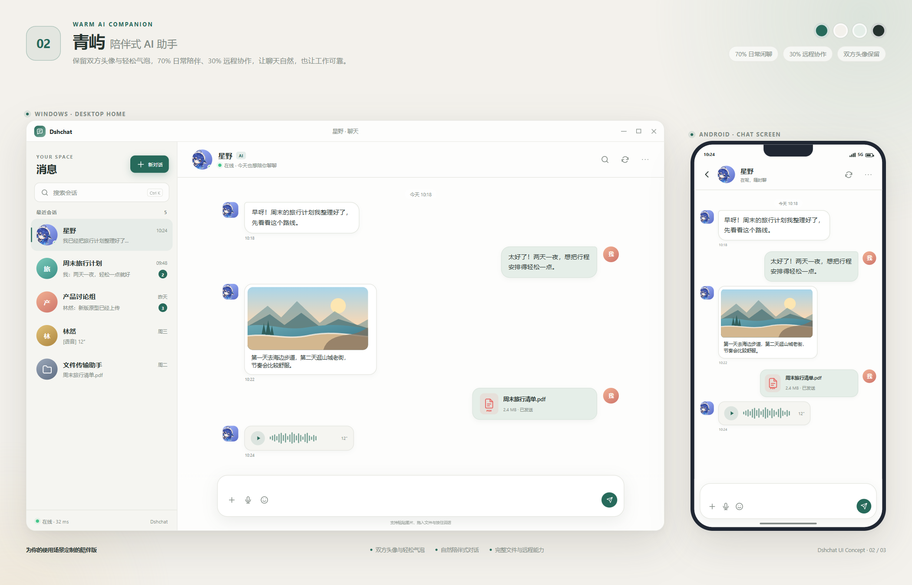
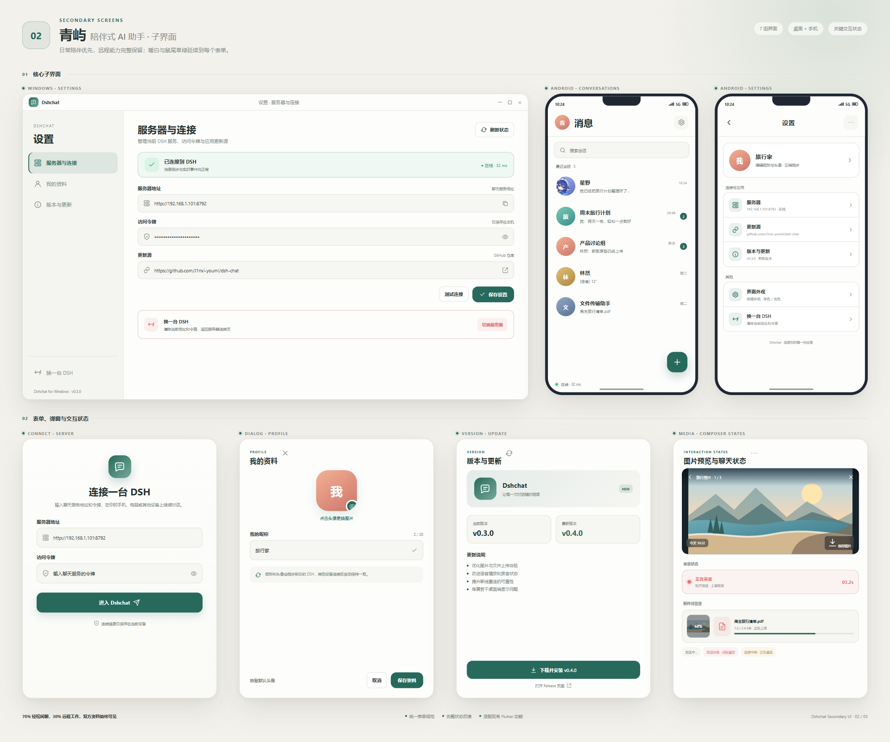

# 青屿

连接任意一台 DSH 的原生聊天客户端。**Flutter 一套代码，Android + Windows。**

界面是 **青屿 · 陪伴版**：暖白底色、鼠尾草绿、双方头像和轻松气泡。  
按 **70% 日常闲聊、30% 远程协作** 来设计——聊天要自然，文件、图片、语音、搜索和服务器管理也一个不少。

> 仓库名仍是 `dsh-chat`，应用显示名统一为「青屿」。

后端是任意一台装着 `dsh-plugin-chat` 的 DSH（手机本机引擎也行，电脑也行）。

## 界面预览





> 预览包含 Windows 双栏主界面与 Android 聊天页；子界面覆盖设置、连接、个人资料、版本更新、图片预览和输入状态。

## 核心能力

- **青屿主题**：暖白底、鼠尾草绿、轻柔阅读排版；桌面双栏、手机单栏，共享同一套组件
- **双方头像与方向气泡**：对方左侧、自己右侧；文字气泡朝向头像，图片/文件/语音使用独立圆角卡片
- **消息**：文字、图片、链接、语音、文件双向收发；`seq` + 幂等发送 + 断线增量补拉，可靠投递
- **聊天交互**：图片点击全屏预览、长按/右键复制文字、会话列表 `Ctrl + K` 聚焦搜索、当前会话消息搜索
- **输入区**：统一 `＋` 附件入口、按住说话、表情面板、自动换行；桌面端拖入文件、`Ctrl + V` 粘贴
- **自定义表情包**：表情面板提供「最近 / 我的表情包 / 表情」标签、搜索、添加和管理删除；表情包随资料云同步，另一端收到 `profile` 事件后自动刷新，点击直接发送
- **我的资料云同步**：昵称 + 头像存服务器，所有设备自动一致
- **设置页**：桌面分栏 / 手机分组；服务器、个人资料、版本与更新、更新源、切换 DSH
- **App 内更新**：设置 → 版本 → 下载并安装（带进度条；GitHub 直连超时自动走 DSH 隧道代理下载）
- **真实连接状态**：显示实时延迟（定时 ping `/healthz`），断线自动重连
- **上传上限**：默认 96MB，跟随服务端配置
- **应用名/图标**：青屿

## 直接下载

`main` 每次提交 CI 都会自动覆盖这几个文件（免登录）：

| 平台 | 链接 | 说明 |
|---|---|---|
| Android | <https://github.com/J1nxi-youmi/dsh-chat/releases/latest/download/dsh-chat.apk> | 传到手机装，允许「安装未知来源」 |
| Windows（安装包） | <https://github.com/J1nxi-youmi/dsh-chat/releases/latest/download/dsh-chat-setup.exe> | 双击安装，可改安装位置、自动建桌面快捷方式 |
| Windows（便携） | <https://github.com/J1nxi-youmi/dsh-chat/releases/latest/download/dsh-chat-windows.zip> | 解压后跑 `dsh_chat.exe` |

> 安装包用固定的 keystore 签名（`tool/android/dsh-chat.jks`），所以 Android 以后可以直接覆盖安装；
> 第一次从旧版本（debug 签名）换过来需要先卸载一次。

## 桌面端体验

- **双栏布局**：左侧会话列表（头像 / 筛选 / 预览 / 时间），右侧居中对话区
- 初始窗口 980×660，最小 780×560
- 会话搜索支持 `Ctrl + K` 聚焦、`Esc` 清空
- Enter 发送，Shift + Enter 换行
- 文件直接拖进聊天框；Ctrl+V 粘贴图片或文件
- 图片点击全屏预览；语音显示波形，按住说话、松开发送、上滑取消

## 手机端体验

- 同一套青屿暖白主题：会话列表 + 气泡对话 + 分组设置
- 头像进入「我的资料」；顶栏搜索会话
- 图片点开大图，链接点开浏览器，文件交给系统程序
- 输入区：`＋` 选择图片/文件、表情面板、按住说话、圆形发送键
- 断线自动重连（SSE），回复一条条冒出来

## 自己构建（不用装 Android SDK / Visual Studio）

仓库里只有 `lib/`、`pubspec.yaml` 和补丁脚本，平台工程由 CI 现生成：

1. 推到 GitHub 的 `main` 分支；
2. **Actions** 里会自动跑 `build-apk` 和 `build-windows`；
3. 成功后在 **Artifacts** 下 `dsh-chat-apk` / `dsh-chat-windows`，同时覆盖到 `latest-build` release。

第一次构建大约 5–8 分钟，之后有缓存会快很多。

> 本地也能编（装 Flutter + Android SDK / Visual Studio 就行）：
> `flutter create --platforms=android . && flutter build apk`。
> 只跑静态检查的话 `flutter pub get && flutter analyze` 就够。

## 连哪台 DSH

App 第一次打开会要两样东西：

| 字段 | 例子 | 从哪来 |
|---|---|---|
| 服务器地址 | `http://192.168.1.101:8792` | 那台 DSH 上 `dsh-plugin-chat` 的端口 |
| 令牌 | `chatdemo123` | 同一个插件的配置 |

- 同一 WiFi：直接填内网 IP；
- 跨网：填中转给的地址（配了 `relayUrl` 的话），或者固定域名的隧道地址。
- 换机器：设置页「换一台 DSH」，重新填即可。

## 后端要做什么

在 DSH 那台机器上**只装一个插件**：本仓库的 [`plugin/`](plugin/README.md)（`dsh-plugin-chat`）。

- 它自带一个 OpenAI 兼容的桥（只监听本机回环，端口可在配置里改），把聊天直接跑成这条 DSH 里的一轮；
  不用再单独装 `dsh-plugin-starlit-bridge`（已经合并进来了）；
- 所有聊天默认写进**同一条会话**（`sessionKey: fixed`）。想写进某条已有会话，
  把它的会话 id 填到插件配置的 `sessionId` 里；留空则自动建一条并一直复用；
- 想接别的大模型也可以：把 `baseUrl` 填成任意 OpenAI 兼容地址即可（留空就用内置桥）。

安装步骤、配置项都在 [plugin/README.md](plugin/README.md)。

然后 App 连 `dsh-plugin-chat` 的地址就行。

## 目录

```
lib/
  main.dart                        入口、启动时读上次连接
  src/
    api.dart                       HTTP + SSE 客户端，断线重连
    models.dart                    会话/消息/附件
    theme.dart                     青屿配色、背景、头像与通用组件
    screens/connect_screen.dart          填地址和令牌
    screens/conversations_screen.dart    手机会话列表
    screens/desktop_home.dart            Windows 双栏主界面
    screens/chat_screen.dart             对话、发消息、录音、选文件、表情
    screens/settings_screen.dart         设置：桌面分栏 / 手机分组
    screens/version_screen.dart          版本与更新
    widgets/message_bubble.dart          气泡：文字/链接/图片/语音/文件
    widgets/message_search_dialog.dart   当前会话消息搜索
  assets/screenshots/                    青屿界面预览
tool/patch_android.sh             CI 里补权限和明文 HTTP
tool/patch_windows.ps1            CI 里给生成的 CMakeLists 加 MSVC 兼容宏
.github/workflows/build.yml       出 APK
.github/workflows/build-windows.yml  出 Windows 包
```

## 已知限制

- iOS 还没做；需要 macOS + Xcode 才能编。
- 语音是「发语音条」，模型听到的是转写文字（后端配了 ASR 才有，没配就只有「语音，约 N 秒」）。
- 附件走 HTTP 直连；如果后端只走中转，图片/语音暂时拿不到。
- 大文件上限默认 96MB：插件 `config.json` 的 `maxUploadBytes`（字节）或网页设置页可改；App 启动时会读 `/healthz` 的上限并跟随。
